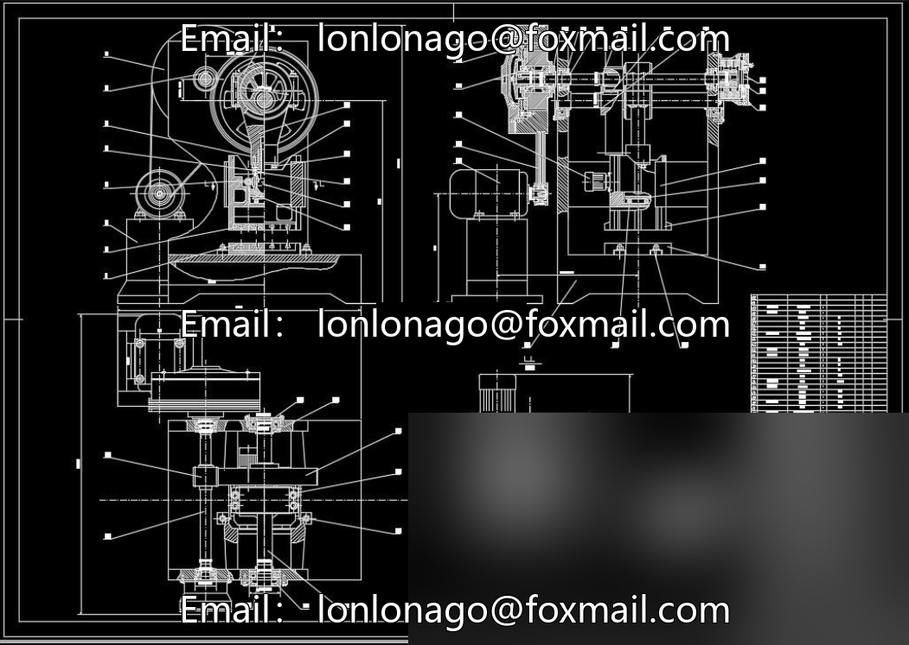
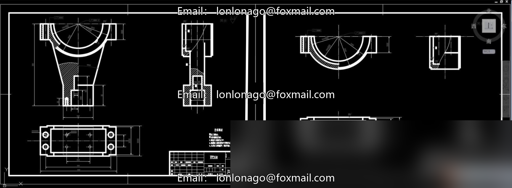
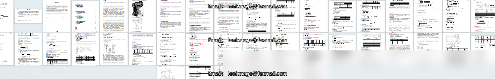
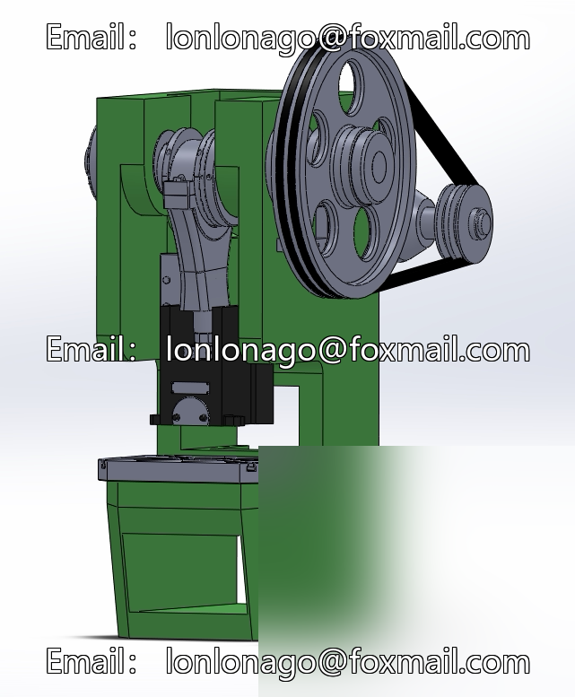

# 431. Crank Press Machine Design Crank Press Machine Design Drawing Crank Press Machine Design CAD

## Body

431. Crank Press Design Crank Press Design Drawing Crank Press Design CAD Drawing
This design documentation contains a detailed design for a crank press, including CAD drawings and instructions.

Crank pressure machine design (complete CAD drawings + design instructions)

Additionally, an optional reference manual for the crank press and a 3D diagram of the crank press are provided, with specific references to the attached figures.

The price is the amount, and will send it as specified.

Purchase requirements
1. All materials are drawing-type (not physical objects), the network has replicability, and after transaction completion, refunds are not accepted. Please consult before purchase for any issues.
2. All materials are for reference and learning purposes for beginners and shall not be used for illegal purposes.
3. Design is a comprehensive test, it is recommended not to copy from the original without modification. For final design, there is no after-sales modification service.

The materials cover crank press design, design drawings, CA drawings and instructions, including CAD drawings and design documents.

<!-- AI_ENRICHED -->

## Images

## Payment

Here is a pay link on Stripe ( https://buy.stripe.com/3cs8yP7sY87d0vu9AB ). Please contact me lonlonago@foxmail.com after funding $89, and I will send you a complete data files , thank you!

